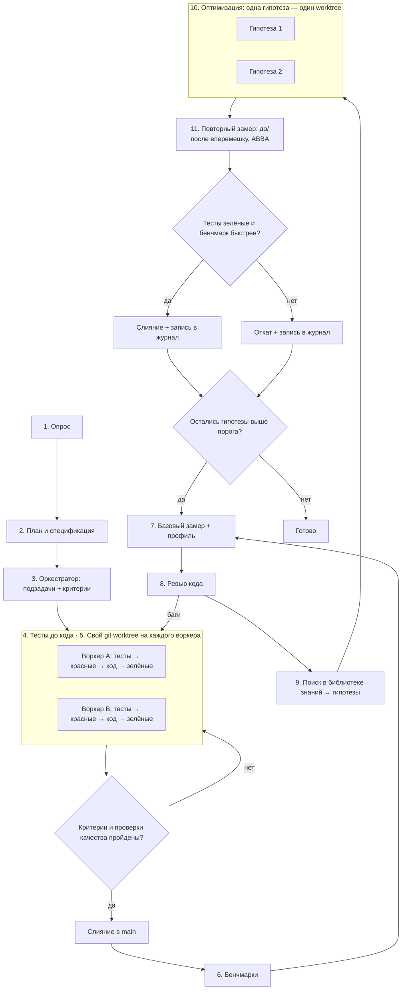

# Пайплайн разработки и оптимизации кода на Node.js

Порядок работы над задачей на Node.js (JavaScript или TypeScript): от постановки до кода с зелёными тестами, затем цикл оптимизации. В цикле код ускоряется только по замерам, а каждая правка опирается на источник из библиотеки знаний скилла. Пайплайн не зависит от предметной области и подходит для веб-сервисов, библиотек, CLI, ботов, обработки данных, десктопных и игровых проектов. Команды проверок качества, бенчмарков и скрипта сравнения проверены на Windows 11 с Node 24.17, npm 11.13, mitata 1.0.34 и Vitest 5.1 (ноябрь 2026).

- [Схема](#схема)
- [Роли и модели](#роли-и-модели)
- [Этапы](#этапы)
- [Обязательные проверки качества](#обязательные-проверки-качества)
- [Этап 6. Бенчмарки](#этап-6-бенчмарки)
- [Этап 7. Базовый замер и профиль](#этап-7-базовый-замер-и-профиль)
- [Этап 8. Ревью кода](#этап-8-ревью-кода)
- [Этап 9. Поиск в библиотеке знаний](#этап-9-поиск-в-библиотеке-знаний)
- [Этапы 10–11. Оптимизация и повторный замер](#этапы-1011-оптимизация-и-повторный-замер)
- [Короткий режим](#короткий-режим)
- [Почему так](#почему-так)

## Схема



## Роли и модели

Пайплайн рассчитан на агента с субагентами. Если субагентов нет, один агент проходит те же этапы последовательно, а вместо worktree использует отдельные ветки.

| Роль | Рекомендуемая модель | Этапы |
| --- | --- | --- |
| Оркестратор: опрос, план, распределение работы, ревью, поиск решений, приёмка | Старшая модель, например Claude Opus 5.5 | 1–3, приёмка, 8, 9, решение на 11 |
| Воркер: основной код, тесты, бенчмарки, оптимизации | Средняя модель, например Claude Sonnet 5.5 | 4, 6, 10 |
| Рутина: простые правки, прогоны команд, сбор цифр | Быстрая модель, например Claude Haiku 4.5 | 4 (рутина), 7, 11 (замер) |

Старшая модель только управляет и проверяет. Основной объём кода пишут более дешёвые модели.

## Этапы

| Этап | Что делает | Команда агенту |
| --- | --- | --- |
| 1. Опрос | Задаёт уточняющие вопросы: цель, ограничения, целевые версии Node (`engines.node`; на ноябрь 2026 поддерживаются 22, 24 и 26), JavaScript или TypeScript, ESM или CommonJS, менеджер пакетов, другие рантаймы (Bun, Deno, Cloudflare Workers), платформы, зависимости, которые нельзя добавлять, требования к задержке, пропускной способности, памяти и времени старта | «Прежде чем начать, задай мне вопросы по задаче» |
| 2. План и спецификация | Фиксирует план и спеку файлом. Отдельно перечисляет горячие пути и бюджет производительности: что, насколько быстрым и с какой памятью должно быть, на какой нагрузке | «Составь план и спецификацию, отдельно перечисли критичные по скорости и памяти места» |
| 3. Оркестратор | Делит план на независимые подзадачи с критериями приёмки. Структуру пакетов, слои и границы модулей сверяет с [architecture.md](architecture.md) | «Разбей план на подзадачи с критериями готовности» |
| 4. Тесты до кода | Пишет тесты по спеке, видит красные, пишет код и чинит до зелёных. Правила для агента — в [testing.md](testing.md) | «Сначала тесты по спеке, запусти — должны быть красными. Потом код, пока все не зелёные» |
| 5. Изоляция | Отдельный git worktree на каждого воркера. В каждом worktree свой `node_modules`: `npm ci` | «Работай в отдельном worktree, main не трогай» |
| Приёмка | Сверяет результат с критериями и [проверками качества](#обязательные-проверки-качества): слияние или возврат | «Проверь ветку по критериям и покажи вывод форматтера, линтера, тайпчекера и тестов» |
| 6. Бенчмарки | Пишет бенчмарки mitata (или Vitest 5) на горячие пути из спеки. После этапа они заморожены | «Напиши бенчмарки на горячие пути из спеки в `benchmarks/` по шаблону `scripts/bench_template.mjs`» |
| 7. Базовый замер + профиль | Снимает базовую линию в 5 прогонов и профиль самого медленного сценария | «Сними 5 прогонов бенчмарков в `bench/before/` и CPU-профиль самого медленного сценария» |
| 8. Ревью кода | Стандартное ревью: баги, безопасность, идиоматичность, типы, асинхронность, архитектура | «Сделай ревью: баги отдельно, замечания по скорости и дизайну отдельно» |
| 9. Поиск в библиотеке знаний | Сопоставляет профиль и замечания ревью с разделами справочников и пишет гипотезы | «По профилю и ревью найди решения в библиотеке знаний и оформи карточки гипотез» |
| 10. Оптимизация | Каждая гипотеза реализуется отдельно, тесты и бенчмарки не меняются | «Реализуй гипотезу N в отдельном worktree, тесты и бенчмарки не трогай» |
| 11. Повторный замер | Прогоняет бенчмарки «до» и «после» вперемешку в порядке ABBA и сравнивает скриптом, оркестратор решает: слить или откатить | «Сними по 5 чередующихся прогонов main и гипотезы и сравни скриптом bench_compare» |

## Обязательные проверки качества

Перед любым слиянием в `main`, и на приёмке, и на этапе 11, ветка проходит минимальный набор проверок. Порядок — от дешёвых и детерминированных к дорогим, чтобы ошибка находилась быстро. Подробности по каждому инструменту и шаблоны `package.json`, `tsconfig.json`, `eslint.config.js`, `.npmrc` и workflow для CI — в [toolchain.md](toolchain.md).

```bash
npm ci                                            # установка строго по package-lock.json
npm install --package-lock-only --ignore-scripts && git diff --exit-code package-lock.json   # lock-файл актуален
npx prettier --check .                            # или biome ci / oxfmt --check — что принято в проекте
npx eslint --max-warnings=0 .                     # или oxlint; предупреждения тоже валят проверку
npx tsc --noEmit                                  # для TypeScript и для JS с JSDoc-типами
node --test                                       # или npx vitest run; порог покрытия — в конфиге
npm audit --omit=dev --audit-level=high           # уязвимости в зависимостях рантайма
npm audit signatures                              # подписи реестра и provenance
```

Оговорки, проверенные на Node 24.17 и npm 11.13:

- `npm ci` пропускает часть расхождений. Если новую зависимость добавили в `package.json`, а в lock она уже есть как транзитивная, `npm ci` завершается с кодом 0, хотя lock устарел. Поэтому нужна вторая строка — проверка, что `npm install --package-lock-only` ничего не меняет.
- `npm ci` печатает результаты аудита, но код выхода всё равно 0. Аудит запускается отдельной командой.
- Полный `npm audit` на свежей установке ESLint 10 с typescript-eslint вернул 1 из-за 10 умеренных уязвимостей в dev-зависимостях. Их «исправление» (`npm audit fix --force`) откатывало ESLint на мажорную версию назад. Поэтому блокирующий аудит — только по зависимостям рантайма и с уровня high, а полный `npm audit` запускается без блокировки, для информации. `npm audit fix --force` в CI не запускайте никогда.
- `min-release-age` в `.npmrc` действует и на `npx`, а точная версия моложе окна падает с `ETARGET`. `npm ci` окно не проверяет: для версий из lock-файла оно не применяется.
- TypeScript 7 (пакет `typescript` с июля 2026) — компилятор на Go без JS API. typescript-eslint с ним не ставится (`ERESOLVE`). Рецепт с alias на `@typescript/typescript6` — в [toolchain.md](toolchain.md) и [typescript.md](typescript.md).
- TypeScript 6 и 7 по умолчанию ставят `types: []`. Без `"types": ["node"]` в `tsconfig.json` тайпчекер не видит типов Node.
- В `node:test` метод `t.assert` нестрогий: `t.assert.equal(1, '1')` проходит. Используйте `node:assert/strict` или `strict*`-методы ([testing.md](testing.md)).

По ситуации добавляются:

- `npm ci --strict-allow-scripts` и закоммиченное поле `allowScripts`, если проект на npm 12: он блокирует install-скрипты зависимостей по умолчанию ([toolchain.md](toolchain.md));
- прогон тестов на всех версиях Node из `engines.node` (матрица в CI);
- `npx knip` — неиспользуемые файлы, экспорты и зависимости;
- `npx --no-install depcruise src` или другой инструмент границ модулей, если границы закреплены правилами ([architecture.md](architecture.md)). dependency-cruiser 18.7 не понимает `typescript@7`: если установлен только TS 7, он проходит 0 модулей и завершается с кодом 0, то есть проверка молча ничего не ловит. Держите рядом TS 6 через alias ([typescript.md](typescript.md)) и проверяйте, что в отчёте ненулевое число модулей;
- `npm pack --dry-run`, `npx publint --strict` и `npx attw --pack .`, если это публикуемый пакет ([domains-client.md](domains-client.md));
- `zizmor .github/workflows`, если менялись workflow GitHub Actions;
- `npx stryker run` по изменённым модулям, если важна сила тестов ([testing.md](testing.md)).

Если проект на pnpm или Yarn, выполните те же шаги их командами (`pnpm install --frozen-lockfile`, `pnpm audit --prod --audit-level high`). Если инструмента нет, скажите об этом и предложите команду установки из [toolchain.md](toolchain.md), а не пропускайте шаг молча.

## Этап 6. Бенчмарки

- **Мерить то, что важно пользователю.** Горячие пути берутся из спеки, а не из догадок воркера. Это может быть разбор входа, обработка запроса, сериализация, запрос к базе, шаг игровой симуляции, рендер шаблона, обработка потока данных.
- **Инструмент по умолчанию — mitata** (1.0.34). Он даёт p25, p50 и p75 в JSON (`run({ format: 'json' })`), функцию `do_not_optimize` против выкидывания мёртвого кода и пакетный режим для коротких функций. Готовый шаблон с прогревом — [scripts/bench_template.mjs](../scripts/bench_template.mjs): скопируйте его в `benchmarks/` и замените примеры.
- **Явный прогрев обязателен.** V8 переводит функцию на оптимизирующий компилятор по числу выполнений, а не по времени. В локальном замере функция работала около 72 мкс на вызов до оптимизации (примерно первые 11 000 вызовов) и 4,3 мкс после. tinybench с `time: 300` успел сделать около 7 600 вызовов и показал результат в 16 раз хуже реального. Шаблон сначала делает 20 000 вызовов и только потом ждёт, пока время пачки стабилизируется: до оптимизации время пачек тоже стабильно, и одна проверка стабильности заканчивает прогрев слишком рано. Подробности — [performance.md → «Как бенчмаркать честно»](performance.md#как-бенчмаркать-честно).
- **Хвост может быть настоящим.** У `data.reduce((a, b) => a + b, 0)` на Node 24 около 3% вызовов шли со скоростью неоптимизированного кода даже после 30 000 вызовов прогрева, без единой деоптимизации; у цикла `for` хвоста не было. Медиана от этого не страдает, но p99 и среднее — да. Если скрипт сравнения предупреждает о `mean/median > 1.25`, сначала проверьте прогрев, а если хвост остаётся, сравнивайте ещё и p99 — для сервисов с требованием к задержке это важнее медианы.
- **Vitest 5** подходит, если в проекте уже есть Vitest. С 5.0 (сентябрь 2026) API другой: `bench` — фикстура теста, а не импорт из `'vitest'`, флагов `--outputJson` и `--compare` больше нет. Прогрев задаётся явно в опциях `bench.compare(..., { warmupIterations: 20_000 })`, иначе действуют умолчания tinybench (250 мс или 16 итераций). Результат для сравнения — JSON-репортёр: `vitest bench --run --reporter=json --outputFile.json=bench/before/run1.json`. Ранг «fastest» в таблице Vitest считается по среднему, а не по медиане; сравнивайте `latency.p50`.
- **bench-node** по умолчанию запрещает V8 оптимизировать функцию (`V8NeverOptimizePlugin`) и потому отвечает на вопрос «что дешевле без оптимизации». Для продакшен-вопроса нужен `plugins: []`.
- **Детерминизм.** Входные данные готовятся вне измеряемой функции, у генераторов случайных чисел фиксированный seed, данные реалистичные по размеру и форме (разные формы объектов меняют скорость в разы). Результат возвращается из функции или передаётся в `do_not_optimize`, иначе V8 может выкинуть работу.
- **Целиком программу** мерьте отдельно: старт CLI — `hyperfine -N --warmup 3 --export-json run1.json 'node cli.js --version'`, HTTP-нагрузку — autocannon, oha или k6 с фиксированной частотой запросов (так не прячутся хвосты задержки), память — `--heap-prof`, `process.memoryUsage()` и heap snapshot. Подробности — [performance.md](performance.md#бенчмарки-mitata-tinybench-vitest-bench-bench-node-hyperfine) и [domains-server.md → «Производительность HTTP и нагрузочное тестирование»](domains-server.md#10-производительность-http-и-нагрузочное-тестирование).
- **Бенчмарки замораживаются.** Как и тесты, они контракт. Если на этапе 10 бенчмарк изменится, сравнение с базовой линией потеряет смысл.

## Этап 7. Базовый замер и профиль

```bash
node -p "process.version + ' V8 ' + process.versions.v8" > bench/before/env.txt   # на чём мерили
for i in 1 2 3 4 5; do
  node benchmarks/bench.mjs > bench/before/run$i.json
done
```

- **Один прогон ничего не доказывает.** Каждый прогон — новый процесс: состояние JIT, раскладка кучи и частота CPU в разных процессах разные. Статистика внутри одного прогона этот шум не видит.
- **Пять прогонов, а не три.** При трёх прогонах на сторону одинаковый код случайно разделяется полностью с вероятностью 10%, при пяти — 0,8%. В локальной проверке три прогона одного и того же кода дали ложное ускорение на 6,5%: прогоны, шедшие сразу после медленного варианта, были систематически быстрее. Скрипт сравнения печатает эту вероятность и предупреждает, если прогонов мало.
- **Одинаковые условия.** Прогоны идут на одной машине, на одной версии Node (запишите `process.version` и версию V8), от сети на ноутбуке, без другой тяжёлой работы. Отладочные флаги (`--inspect`, покрытие, `--trace-*`) выключены. На Windows таймер тикает с шагом 100 нс, поэтому функции короче нескольких микросекунд мерьте только в пакетном режиме.
- **Профиль самого медленного сценария:**

  | Инструмент | Команда | Что даёт |
  | --- | --- | --- |
  | Встроенный CPU-профайлер V8 | `node --cpu-prof --cpu-prof-dir=prof app.js` | файл `.cpuprofile` (JSON) для Chrome DevTools, VS Code или speedscope; работает на Windows без прав администратора |
  | `@platformatic/flame` | `npx @platformatic/flame run app.js` | CPU и heap одновременно, HTML flame graph и отчёт о горячих местах в Markdown, который агент читает напрямую |
  | Профайлер выделений памяти | `node --heap-prof app.js` | какие стеки вызовов выделяют память |
  | Трассировка оптимизаций | `node --trace-opt --trace-deopt app.js` | когда функции оптимизируются и почему деоптимизируются |
  | Задержка event loop | `perf_hooks.monitorEventLoopDelay()` и `performance.eventLoopUtilization()` | блокирует ли код event loop |
  | Linux `perf` | `perf record -g -- node --perf-basic-prof app.js` | нативный код, GC и JS в одном flame graph |

  Clinic.js больше не поддерживается: последний релиз в 2023 году, и README предупреждает о неточных результатах. Подробности и выбор — [performance.md → «Профилирование»](performance.md#профилирование).
- Итог этапа — таблица: бенчмарк, медиана, разброс между прогонами, топ горячих функций из профиля.
- Если ревью на этапе 8 нашло баги и код после исправления поменялся, базовую линию нужно снять заново.

## Этап 8. Ревью кода

Ревью идёт до оптимизаций, потому что ускорять имеет смысл уже правильный код.

- Чеклисты:
  - идиоматичный код — [idioms-patterns.md → «Чеклист code review: идиоматичный Node»](idioms-patterns.md#чеклист-code-review-идиоматичный-node);
  - типы и валидация на границах — [typescript.md → «Чеклист ревью типизации»](typescript.md#чеклист-ревью-типизации);
  - тесты — [testing.md → «Чеклист ревью тестов»](testing.md#27-чеклист-ревью-тестов);
  - event loop, worker threads, потоки данных и нативный код — [concurrency-async-native.md → «Чеклист ревью»](concurrency-async-native.md#чеклист-ревью);
  - серверный код и безопасность — [domains-server.md → «Чеклист ревью серверного кода»](domains-server.md#чеклист-ревью-серверного-кода);
  - архитектура — [architecture.md → «Чеклист ревью архитектуры»](architecture.md#чеклист-ревью-архитектуры).
- Находки делятся на две группы:
  - **баги** — неверное поведение, исключение на корректном входе, промисы без `await` и без обработки ошибки, гонки, блокирующие вызовы в event loop, утечки слушателей и таймеров, тела ответов `fetch`/undici, которые никто не дочитал (пул соединений заканчивается), игнорирование backpressure, prototype pollution, инъекции, path traversal, SSRF, ReDoS. Возвращаются на этап 4 с тестом, который воспроизводит баг;
  - **можно сделать лучше** — скорость, память, дизайн, идиоматичность. Идут на вход этапа 9.

## Этап 9. Поиск в библиотеке знаний

Оркестратор идёт от симптома к справочнику. Главная точка входа — таблица «Симптом → техника → источник» в [performance.md](performance.md#симптом--техника--источник).

| Что видно в профиле или ревью | Куда смотреть |
| --- | --- |
| Горячая функция на чистом JS, много вызовов, разные формы объектов, `delete`, полиморфный доступ к свойствам | [performance.md → «Симптом → техника → источник»](performance.md#симптом--техника--источник), [«Внутренности V8, влияющие на скорость»](performance.md#внутренности-v8-влияющие-на-скорость), [«Техники на чистом JavaScript»](performance.md#техники-на-чистом-javascript) |
| Много объектов, рост памяти, долгие паузы GC, утечки | [performance.md → «Память и GC»](performance.md#память-и-gc) |
| JSON, Buffer, строки, сериализация | [performance.md → «Буферы, строки и JSON»](performance.md#буферы-строки-и-json) |
| Большие данные целиком в памяти, медленные потоки, нет backpressure | [performance.md → «Потоки (streams)»](performance.md#потоки-streams), [concurrency-async-native.md](concurrency-async-native.md) |
| Event loop заблокирован, CPU-задача не масштабируется по ядрам, забит пул потоков libuv | [concurrency-async-native.md → «Выбор инструмента по нагрузке»](concurrency-async-native.md#выбор-инструмента-по-нагрузке) |
| Горячую функцию не ускорить на JS | [performance.md → «Выход за пределы JS»](performance.md#выход-за-пределы-js), [concurrency-async-native.md → «Нативные расширения и FFI»](concurrency-async-native.md#нативные-расширения-и-ffi) |
| Медленный старт CLI, сервера или serverless-функции | [performance.md → «Старт программы»](performance.md#старт-программы), [domains-client.md](domains-client.md) |
| Низкий RPS, высокая задержка, медленный HTTP-клиент, N+1 запросы к базе | [performance.md → «HTTP-сервер и клиент»](performance.md#http-сервер-и-клиент), [domains-server.md](domains-server.md) |
| Лишние зависимости, которые заменяет встроенный API Node | [idioms-patterns.md](idioms-patterns.md) |
| Неудобные абстракции, лишние классы, глубокое наследование | [idioms-patterns.md → «Мини-каталог паттернов»](idioms-patterns.md#мини-каталог-паттернов), [«Антипаттерны»](idioms-patterns.md#антипаттерны) |
| Запутанные зависимости модулей, циклические импорты, долгая сборка монорепозитория | [architecture.md](architecture.md), [toolchain.md](toolchain.md) |
| Медленная проверка типов или сборка | [typescript.md](typescript.md), [toolchain.md](toolchain.md) |
| Нужно глубже разобраться в теме | [books.md](books.md) |

Результат этапа — список карточек гипотез, отсортированный по ожидаемому эффекту:

```text
Гипотеза N: <что меняем>
Где: <файл и функция>
Почему: <горячее место из профиля или замечание ревью>
Источник: <ссылка из библиотеки знаний>
Ожидаемый эффект: <какой бенчмарк и насколько должен ускориться, сколько памяти уйдёт>
Риск: <что может сломаться, нужна ли новая зависимость или нативный код, совместимость с версиями Node из engines и с другими рантаймами>
```

Если в библиотеке нет решения под найденную проблему, это пишется в карточке прямо, без выдуманного решения. Такой пробел — повод дополнить библиотеку.

## Этапы 10–11. Оптимизация и повторный замер

Каждая гипотеза реализуется в своём worktree, чтобы эффект был виден отдельно. Для решения базовая линия снимается **заново, вперемешку с прогонами гипотезы**. Старая линия из этапа 7 для этого не годится: за время работы над гипотезой состояние машины меняется (частота CPU, нагрев, фоновые задачи), и дрейф легко принять за ускорение. Порядок внутри пары меняется (ABBA): прогон, идущий сразу после другого варианта, бывает систематически быстрее или медленнее.

```bash
# ../wt-main — worktree с main, ../wt-hyp — worktree с гипотезой; в обоих выполнен npm ci
OUT=bench; mkdir -p "$OUT/before" "$OUT/after"
for i in 1 2 3 4 5; do
  if [ $((i % 2)) = 1 ]; then
    (cd ../wt-main && node benchmarks/bench.mjs > "$OLDPWD/$OUT/before/run$i.json")
    (cd ../wt-hyp  && node benchmarks/bench.mjs > "$OLDPWD/$OUT/after/run$i.json")
  else
    (cd ../wt-hyp  && node benchmarks/bench.mjs > "$OLDPWD/$OUT/after/run$i.json")
    (cd ../wt-main && node benchmarks/bench.mjs > "$OLDPWD/$OUT/before/run$i.json")
  fi
done
node <путь к скиллу>/scripts/bench_compare.mjs "$OUT/before" "$OUT/after" --threshold 5
```

На Windows цикл работает в Git Bash. Для Vitest 5 замените строку прогона на `npx vitest bench --run --reporter=json --outputFile.json=...`, для CLI — на `hyperfine -N --runs 30 --export-json ... '<команда>'`.

[bench_compare.mjs](../scripts/bench_compare.mjs) — однофайловый скрипт без зависимостей для Node 18+. Он принимает JSON одного прогона или папку с несколькими прогонами и сам определяет формат: mitata, JSON-репортёр Vitest 5, hyperfine или общий формат `{ "unit": "ms", "benchmarks": [{ "name", "median", "q1", "q3", "mean" }] }`, в который можно выгрузить tinybench или любой другой инструмент. Для каждого бенчмарка скрипт печатает медианы и изменение:

- вердикт `faster` или `slower` ставится, только если медиана медиан сдвинулась больше порога и медианы всех прогонов одной стороны лежат строго по одну сторону от другой; иначе `same`;
- если прогонов мало, скрипт печатает вероятность, с которой одинаковый код разделился бы случайно; для одного прогона на сторону он сравнивает межквартильные интервалы и предупреждает, что такому вердикту доверять нельзя;
- если среднее больше медианы в 1,25 раза, скрипт предупреждает о тяжёлом хвосте выборки: недогрев JIT, GC, деоптимизации или редкие медленные вызовы, которые прогрев не убирает. Вердикт строится по медианам, но бенчмарк стоит проверить с `--trace-opt --trace-deopt`;
- код выхода 1 — хотя бы один бенчмарк замедлился, 2 — ошибка ввода.

Проверено на mitata 1.0.34 и Vitest 5.1.0 (Node 24.17, Windows 11): пять прогонов неизменённого кода в порядке ABBA получили `same`, замедление в 5 раз — `slower` с кодом выхода 1.

Гипотеза сливается в `main`, только если выполнены все условия:

1. Все [проверки качества](#обязательные-проверки-качества) пройдены, тесты зелёные.
2. У целевого бенчмарка вердикт `faster`, а выигрыш не меньше порога из спеки. Порог по умолчанию — 5%. Для микробенчмарков короче нескольких микросекунд берите 10%.
3. Остальные бенчмарки не получили `slower`, бюджет памяти из спеки не превышен.
4. Код не стал заметно хуже: оркестратор коротко проверяет правку. Новая зависимость или нативный код (Node-API, napi-rs, WebAssembly, `node:ffi`) оправданы выигрышем и собираются на всех целевых платформах. Тесты проходят на всех версиях Node из `engines.node` и, если нужно, на других рантаймах.

Иначе worktree удаляется. В обоих случаях результат записывается в журнал оптимизаций, например `docs/perf-log.md`:

| Гипотеза | Источник | До | После | Решение |
| --- | --- | --- | --- | --- |
| `Array.includes` → `Set.has` для проверки в `filterKnown` | ссылка из библиотеки | 1,82 мс | 0,41 мс | слита |

Журнал не даёт повторно проверять отклонённые идеи. Если гипотезы сливались, следующий круг начинается с нового main. Цикл 7–11 повторяется, пока остаются гипотезы с ожидаемым эффектом выше порога.

## Короткий режим

Для небольшой задачи (одна функция, один баг) весь пайплайн избыточен. Достаточно:

1. Тест, который воспроизводит задачу.
2. Код до зелёного теста.
3. [Проверки качества](#обязательные-проверки-качества).
4. Ревью по чеклисту из [idioms-patterns.md](idioms-patterns.md#чеклист-code-review-идиоматичный-node).

Цикл оптимизации запускается, только если в задаче есть требование к скорости или памяти или профиль показал проблему.

## Почему так

- **Тесты — это контракт.** Если тесты написаны до кода, агент не подгонит их под уже сделанное. Фраза «готово, всё работает» без зелёного прогона ничего не значит.
- **Бенчмарки — тоже контракт.** Их пишут до оптимизаций и не трогают, поэтому «стало быстрее» подтверждается цифрами, а не ощущением.
- **JIT нужно прогреть.** В Node одна и та же функция работает в разы медленнее до оптимизации, чем после. Без прогрева бенчмарк меряет не тот код, который работает в продакшене.
- **Шум измеряется, а не предполагается.** Пять чередующихся прогонов в порядке ABBA показывают разброс между процессами и гасят эффект порядка. Одиночный замер выдаёт шум за ускорение.
- **Сначала корректность, потом скорость.** Ревью стоит до оптимизаций, и ускорять приходится уже правильный код.
- **Решения берутся из источников.** Каждая гипотеза ссылается на статью, доклад или книгу из библиотеки. Это отсекает выдуманные «оптимизации» и сразу даёт материал для разбора.
- **Одна гипотеза — один worktree.** Эффект каждой правки виден отдельно, и неудачную легко откатить, не задев удачные.
- **Worktree защищает main.** Параллельные воркеры не мешают друг другу и не ломают основную ветку.
